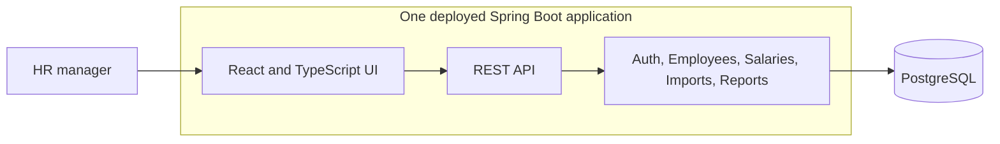

# Salary Management High-Level Design

**Purpose:** Show how the assessment product fits together. See [requirements](./requirements.md) for product scope and the [low-level design](./low-level-design.md) for data, API, and validation rules.

## System view

The UI and API share one origin. Spring Boot serves the built React app, applies business rules, and stores data in PostgreSQL. The backend is one application with clear modules rather than separate services. PostgreSQL holds employees and salaries. Authentication, dated salary records, import previews, and audit events are additional choices already built; the assessment only requires one HR manager and current salary.

## Main product flows

1. **Find an employee:** HR searches or filters the directory. The API returns a page of employees and their current annual gross base salary; the browser does not load all 10,000 records.
2. **Manage salary:** HR creates or updates an employee's base salary in their local currency. The existing dated-record design preserves previous values and audits changes, although history is beyond the requested minimum.
3. **Answer required pay questions:** HR sees minimum, maximum, and average current salary for a country, then average current salary by job title within that country. Values are separated by currency.
4. **Use optional workflows:** The existing CSV preview/import supports bulk entry. Department, total, and median insights provide secondary context without displacing the required reports.

## Security, scale, and deployment

The implemented HR session protects salary data, although authentication is not required for the assessment. Server-side validation, audit history, and change-conflict checks protect data integrity. Application logs exclude salary values and CSV contents. Indexed database queries, server-side pagination, and database aggregation keep the experience usable with the required 10,000 seeded employees.

One deployable container contains the UI and API; persistent PostgreSQL is deployed separately. Database migrations and a repeatable synthetic-data seed support setup and delivery. The application exposes health checks for deployment monitoring.

## Key decisions

A modular monolith and one-origin deployment keep transactions and operations straightforward at this scale. Reports use defined calculations instead of open-ended AI answers. Seed salaries use local currency; the application displays the recorded currency and does not convert or combine different currencies. The API currently validates ISO currency codes without enforcing a country-to-currency mapping. Payroll, bonuses, allowances, deductions, native Excel upload, and multi-role approvals remain outside the first release; the requirements document distinguishes requested scope from our additions.
