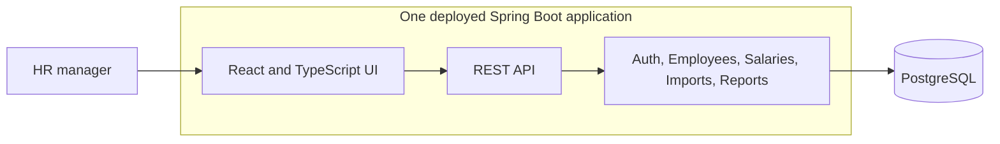

# Salary Management High-Level Design

**Purpose:** Show how the assessment product fits together. See [requirements](./requirements.md) for product scope and the [low-level design](./low-level-design.md) for data, API, and validation rules.

## System view

The UI and API share one origin. Spring Boot serves the built React app, authenticates the HR user, applies business rules, and stores data in PostgreSQL. The backend is one application with clear modules rather than separate services. PostgreSQL holds employees, dated salary records, import previews, and audit events.

## Main product flows

1. **Find an employee:** HR searches or filters the directory. The API returns a page of employees and their current salary; the browser does not load all 10,000 records.
2. **Change salary:** HR records an annual base salary with a currency and effective date. The application preserves earlier records and writes an audit event. Corrections are also audited.
3. **Import a CSV:** HR uploads a file, reviews proposed creates, updates, and row errors, then commits it. The entire file succeeds together; a stale preview requires a new review.
4. **Answer pay questions:** HR filters current compensation reports by country or department. The API calculates headcount, total, average, and median; monetary results remain separated by currency.

## Security, scale, and deployment

An authenticated HR session protects all salary data. Server-side validation, audit history, and change-conflict checks protect data integrity. Application logs exclude salary values and CSV contents. Indexed database queries, server-side pagination, and database aggregation keep the experience usable with the required 10,000 seeded employees.

One deployable container contains the UI and API; persistent PostgreSQL is deployed separately. Database migrations and a repeatable synthetic-data seed support setup and delivery. The application exposes health checks for deployment monitoring.

## Key decisions

A modular monolith and one-origin deployment keep authentication, transactions, and operations straightforward at this scale. Reports use defined calculations instead of open-ended AI answers. Salary remains in local currency because no exchange-rate policy is defined. Payroll, tax, bonuses, native Excel upload, and multi-role approvals are outside the first release; the requirements document records the full scope rationale.
